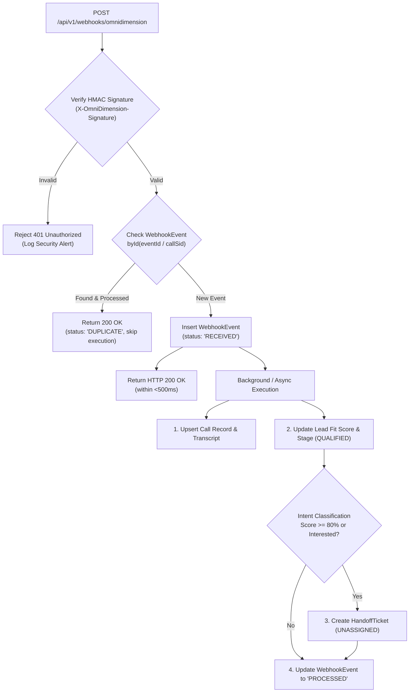

# JusBid AI Sales Agency — Backend Architecture Review & Implementation Checklist

**Role:** Senior Backend Architect & TypeScript Engineer  
**Scope:** Backend System Architecture (`backend/`), MongoDB Schemas, OmniDimension Gateway, Webhook Ingestion, and Governance Engine  
**Working Directory:** `D:\JusBid\Jusbid ai sales agent`  
**Status:** Read-Only Review & Implementation Blueprint (Step 1)  

---

## Classification Legend
Every statement, architectural choice, and specification in this checklist is strictly classified into one of three tiers:
* **`[Confirmed]`** — Explicitly mandated by project requirements, confirmed business rules, or existing repository constraints.
* **`[Recommended]`** — Architectural industry best practices, patterns, and design decisions tailored to Node.js/Express, TypeScript, and MongoDB.
* **`[Requires verification]`** — External variables, third-party provider payloads, infrastructure URLs, or legacy JusBid specifications that require external confirmation before coding.

---

## 1. Backend Architecture Overview

### 1.1 Architectural Pattern
* **`[Confirmed]`** The backend will reside in an isolated `backend/` directory with its own `package.json`, `tsconfig.json`, and dependency tree, leaving the existing React frontend untouched.
* **`[Confirmed]`** Layered Architecture with strict separation of concerns:
  ```
  HTTP Ingress (Express Routes)
    └── Request Validation & RBAC Middleware
         └── Controller Layer (HTTP Request / Response Handling)
              └── Service Layer (Business Logic & Governance Rules)
                   ├── Data Access Layer (Mongoose Models & Repositories)
                   └── Integration Gateway (OmniDimension Adapter & Webhook Ingest)
  ```
* **`[Confirmed]`** The frontend and backend communicate strictly via decoupled REST APIs and Webhook endpoints.
* **`[Recommended]`** Decouple incoming webhooks from heavy background processing using an event-driven or worker-ready task interface (allowing fast `<500ms` acknowledgments).
* **`[Recommended]`** Maintain an Anti-Corruption Layer (ACL) between MongoDB internal schemas and frontend API responses so database optimizations never break the client.

---

## 2. Target Directory Structure (`backend/`)

* **`[Confirmed]`** The backend folder structure isolates models, routes, controllers, services, middleware, and integrations:

```
backend/
├── package.json
├── tsconfig.json
├── .env.example
├── src/
│   ├── app.ts                        # Express app initialization, middleware wiring
│   ├── server.ts                     # HTTP listener & database connection lifecycle
│   ├── config/
│   │   ├── env.config.ts             # Typed environment variables validation (Zod/Joi) [Recommended]
│   │   └── database.ts               # Mongoose connection pooling & lifecycle hooks [Confirmed]
│   ├── constants/
│   │   ├── roles.ts                  # RBAC role definitions [Confirmed]
│   │   └── governance.ts             # Calling hours, compliance bounds, SLA limits [Confirmed]
│   ├── types/
│   │   ├── express.d.ts              # Extended Express Request (authenticated user context) [Confirmed]
│   │   └── common.ts                 # Standard API response & pagination types [Confirmed]
│   ├── models/
│   │   ├── lead.model.ts             # Lead & Hotelier Property schema [Confirmed]
│   │   ├── campaign.model.ts         # Outreach Calling Blitz schema [Confirmed]
│   │   ├── agent.model.ts            # AI Voice Agent profile schema [Confirmed]
│   │   ├── call.model.ts             # Call Session & Transcript schema [Confirmed]
│   │   ├── handoff.model.ts          # Human Specialist Handoff Ticket schema [Confirmed]
│   │   ├── followup.model.ts         # Follow-up Task schema [Confirmed]
│   │   ├── user.model.ts             # Team Member / Operator account schema [Confirmed]
│   │   ├── policy.model.ts           # System Settings & Blacklist schema [Confirmed]
│   │   ├── webhook-event.model.ts    # [NEW] Idempotent Webhook Log schema [Confirmed]
│   │   └── audit-event.model.ts      # [NEW] Immutable Compliance Audit Log schema [Confirmed]
│   ├── middleware/
│   │   ├── auth.middleware.ts        # JWT token verification & session validation [Confirmed]
│   │   ├── rbac.middleware.ts        # Role-based capability authorization guard [Confirmed]
│   │   ├── validate.middleware.ts    # Request body/query validation schema runner [Recommended]
│   │   ├── webhook-auth.ts           # Webhook signature validation guard [Confirmed]
│   │   └── error.middleware.ts       # Centralized error handler & status normalizer [Confirmed]
│   ├── services/
│   │   ├── auth.service.ts           # Password hashing, token issuance, user sessions [Confirmed]
│   │   ├── lead.service.ts           # Lead state machine & qualification logic [Confirmed]
│   │   ├── campaign.service.ts       # Campaign scheduling & target filtering [Confirmed]
│   │   ├── call.service.ts           # Call record creation & outcome syncing [Confirmed]
│   │   ├── handoff.service.ts        # Handoff assignment, checklist & certification [Confirmed]
│   │   ├── followup.service.ts       # Callback task scheduling & SLA tracking [Confirmed]
│   │   ├── team.service.ts           # Team performance aggregation & deal counts [Confirmed]
│   │   ├── analytics.service.ts      # MongoDB aggregations for KPIs & trends [Confirmed]
│   │   ├── audit.service.ts          # Immutable audit event writer [Confirmed]
│   │   └── omnidimension/
│   │       ├── client.ts             # Outbound OmniDimension API client [Confirmed]
│   │       ├── types.ts              # OmniDimension request/response interfaces [Requires verification]
│   │       └── webhook.service.ts    # Idempotent webhook parser & intent dispatcher [Confirmed]
│   ├── controllers/
│   │   ├── auth.controller.ts
│   │   ├── lead.controller.ts
│   │   ├── campaign.controller.ts
│   │   ├── agent.controller.ts
│   │   ├── call.controller.ts
│   │   ├── handoff.controller.ts
│   │   ├── followup.controller.ts
│   │   ├── team.controller.ts
│   │   ├── analytics.controller.ts
│   │   ├── settings.controller.ts
│   │   └── webhook.controller.ts
│   ├── routes/
│   │   ├── index.ts                  # Master API v1 router mounting [Confirmed]
│   │   ├── auth.routes.ts
│   │   ├── lead.routes.ts
│   │   ├── campaign.routes.ts
│   │   ├── agent.routes.ts
│   │   ├── call.routes.ts
│   │   ├── handoff.routes.ts
│   │   ├── followup.routes.ts
│   │   ├── team.routes.ts
│   │   ├── analytics.routes.ts
│   │   ├── settings.routes.ts
│   │   └── webhook.routes.ts
│   └── utils/
│       ├── logger.ts                 # Structured logger (Winston/Pino) [Recommended]
│       ├── api-response.ts           # Standardized JSON response envelope [Recommended]
│       └── crypto.ts                 # Timing-safe HMAC comparison & hashing [Confirmed]
```

---

## 3. Dependencies Specification (`backend/package.json`)

### 3.1 Production Dependencies
* **`[Confirmed]`** `express` (`^4.21.0` or `^5.0.0`) — HTTP server framework.
* **`[Confirmed]`** `mongoose` (`^8.8.0`) — MongoDB ODM and schema validation.
* **`[Confirmed]`** `dotenv` (`^16.4.5`) — Environment configuration management.
* **`[Confirmed]`** `cors` (`^2.8.5`) — Cross-Origin Resource Sharing handling.
* **`[Confirmed]`** `helmet` (`^8.0.0`) — Secure HTTP response headers.
* **`[Recommended]`** `zod` (`^3.23.8`) — Runtime type-safe request payload validation.
* **`[Recommended]`** `jsonwebtoken` (`^9.0.2`) — Stateless JWT issuance and verification.
* **`[Recommended]`** `bcryptjs` or `argon2` (`^2.4.3` / `^0.41.1`) — Cryptographic password hashing.
* **`[Recommended]`** `cookie-parser` (`^1.4.7`) — Secure `HttpOnly` cookie extraction.
* **`[Recommended]`** `pino` (`^9.5.0`) & `pino-http` — High-performance structured logging.

### 3.2 Development Dependencies
* **`[Confirmed]`** `typescript` (`^5.6.0`) — TypeScript compiler.
* **`[Confirmed]`** `tsx` or `ts-node-dev` (`^4.19.0`) — Development server with hot-reload.
* **`[Confirmed]`** `@types/node`, `@types/express`, `@types/cors`, `@types/jsonwebtoken`, `@types/cookie-parser` — Type definitions.

---

## 4. Database Entity Relationships & Mongoose Models

### 4.1 Missing Entities Included
1. **`[Confirmed]` `WebhookEvent` Model:**
   * **Purpose:** Ensures strict **idempotency** and raw audit retention for incoming OmniDimension payloads.
   * **Fields:** `eventId` (unique indexed string), `provider` (`'omnidimension'`), `eventType` (string), `payload` (Schema.Types.Mixed), `signature` (string), `signatureVerified` (boolean), `status` (`'RECEIVED'`, `'PROCESSED'`, `'FAILED'`, `'DUPLICATE'`, `'IGNORED'`), `processedAt` (Date), `errorMessage` (string, optional), `attempts` (number).
   * **Indexes:** `{ eventId: 1 }` (unique), `{ createdAt: 1 }` (TTL index optional for 30-day retention).

2. **`[Confirmed]` `AuditEvent` Model:**
   * **Purpose:** Immutable legal and compliance ledger for every business-critical action (especially onboarding transitions and agent reassignments).
   * **Fields:** `entityType` (`'LEAD'`, `'HANDOFF'`, `'CALL'`, `'POLICY'`), `entityId` (ObjectId), `action` (e.g. `'SPECIALIST_ASSIGNED'`, `'MILESTONE_VERIFIED'`, `'ONBOARDING_CERTIFIED'`, `'OUTCOME_OVERRIDDEN'`), `actorId` (ObjectId/String), `actorRole` (string), `previousState` (Mixed), `newState` (Mixed), `ipAddress` (string), `timestamp` (Date, default `Date.now`).
   * **Indexes:** `{ entityId: 1, timestamp: -1 }`, `{ action: 1 }`.

### 4.2 Complete Domain Entity Models Matrix

| Entity | Primary Key | Foreign Key References | Embedded Sub-Documents | Key Indexes |
| :--- | :--- | :--- | :--- | :--- |
| **`User` (Team Member)** | `_id` | N/A | `assignedProperties` (array) | `{ email: 1 }` (unique), `{ role: 1 }` |
| **`Lead`** | `_id` | `assignedCampaignId`, `assignedAgentId`, `activeHandoffId` | `tags` | `{ primaryPhone: 1 }` (unique), `{ pipelineStage: 1, fitScore: -1 }` |
| **`Campaign`** | `_id` | `assignedAgentId` | `targetRegions`, `scheduleDays`, `suppressionRuleIds` | `{ status: 1 }`, `{ assignedAgentId: 1 }` |
| **`AiVoiceAgent`** | `_id` | N/A | `faqRepository`, `escalationTriggers`, `supportedLanguages` | `{ name: 1 }` (unique), `{ omnidimensionAgentId: 1 }` |
| **`Call`** | `_id` | `leadId`, `campaignId`, `agentId` | `transcript` (array of turns), `objectionsDetected`, `telemetry` | `{ omnidimensionCallSid: 1 }` (unique), `{ leadId: 1, createdAt: -1 }`, `{ outcome: 1 }` |
| **`HandoffTicket`** | `_id` | `leadId`, `sourceCallId`, `assignedSpecialistId` | `checklist` (5 milestones), `contactAttempts`, `internalNotes` | `{ leadId: 1 }`, `{ status: 1, priority: 1 }`, `{ assignedSpecialistId: 1 }` |
| **`FollowupTask`** | `_id` | `leadId`, `handoffId`, `assignedSpecialistId` | N/A | `{ status: 1, scheduledAt: 1 }`, `{ assignedSpecialistId: 1 }` |
| **`SettingsPolicy`** | `_id` | N/A | `approvedClaims`, `prohibitedClaims` | Singleton document pattern |
| **`Blacklist`** | `_id` | `addedByUserId` | N/A | `{ phone: 1 }` (unique), `{ status: 1 }`, `{ expiresAt: 1 }` |
| **`WebhookEvent`** | `_id` | N/A | `payload` (raw incoming JSON) | `{ eventId: 1 }` (unique), `{ status: 1 }` |
| **`AuditEvent`** | `_id` | `entityId`, `actorId` | `previousState`, `newState` | `{ entityId: 1, timestamp: -1 }`, `{ action: 1 }` |

---

## 6. Authentication & Authorization (RBAC) Architecture

* **`[Confirmed]`** Protected APIs will require authentication prior to resource exposure.
* **`[Recommended]`** Implement Stateless JWT sessions delivered via `HttpOnly`, `SameSite=Strict` secure cookies to eliminate local browser storage risks.
* **`[Confirmed]`** Role-Based Access Control (RBAC) hierarchy enforced via Express middleware:
  * **`Admin`** — Full read/write access across all routes, user management, policy rules, and system configurations.
  * **`Sales Director`** — Full access to campaigns, leads, and analytics; read access to system policies.
  * **`Senior Onboarding Specialist`** — Full access to the Handoff Queue, specialist reassignments, milestone completion, notes, and **final certified onboarding sign-off**.
  * **`Integration Lead`** — Read-only access to pipeline, write access to telemetry and provider credentials.
  * **`Auditor`** — Strict read-only access across transcripts, recordings, and immutable audit logs.
* **`[Confirmed]`** Core Governance Guard:
  * The certification endpoint (`POST /api/v1/handoffs/:id/certify`) must strictly require `role in ['Admin', 'Senior Onboarding Specialist']`.

---

## 7. Webhook Architecture & Idempotency Engine



* **`[Confirmed]`** Inbound webhooks must be verified using timing-safe cryptographic comparison.
* **`[Confirmed]`** Idempotency is enforced by keying against OmniDimension's external `eventId` or `callSid` inside the `WebhookEvent` collection.
* **`[Confirmed]`** Fast HTTP `200 OK` acknowledgment prevents upstream timeout retries while heavy transcript parsing executes.
* **`[Confirmed]`** Under no circumstances does a webhook event trigger `Lead.pipelineStage = 'ONBOARDED'`.

---

## 8. API Module Implementation Sequence

* **`[Recommended]`** The backend implementation sequence proceeds in 6 structured stages:

```
Stage 1: Foundation & Infrastructure
  ├── Server bootstrap, TypeScript config, Express app initialization
  ├── MongoDB connection pooling, graceful shutdown handlers
  └── Global middleware (Helmet, CORS, Pino logger, standard error handler)

Stage 2: Core Domain Entities & Database Schemas
  ├── Mongoose schemas: Lead, Campaign, Agent, Call, Handoff, Followup, User, Policy
  ├── Implement WebhookEvent and AuditEvent models
  └── Database index validation and unique constraints

Stage 3: Authentication, RBAC & User Management
  ├── AuthService (login, me, logout, password hashing)
  ├── AuthMiddleware (JWT verification) & RbacMiddleware (role guards)
  └── User/Team endpoints (`/api/v1/auth`, `/api/v1/team`)

Stage 4: Sales Pipeline, Leads & Campaign Management
  ├── LeadService & CallService (CRUD, pagination, filtering)
  ├── CampaignService (campaign creation, status management, schedule validation)
  └── AgentService (AI voice fleet prompt configurations and testing)

Stage 5: Human Onboarding Lifecycle & Governance Engine
  ├── HandoffService (ticket queue, specialist reassignments, milestone toggles)
  ├── FollowupService (callback scheduling, reschedule, completion)
  ├── Final Certification Endpoint (`/handoffs/:id/certify` with audit logging)
  └── Analytics aggregations (`/api/v1/analytics/*`)

Stage 6: OmniDimension Gateway & Inbound Webhooks
  ├── OmniDimension Client (outbound dispatch simulation/adapter)
  ├── Webhook ingestion endpoint with timing-safe signature checking
  └── End-to-end testing of the 7-step lead-to-onboarded lifecycle
```

---

## 9. Security & Governance Requirements

* **`[Confirmed]` Provider Credential Isolation:**
  * All OmniDimension API tokens, SIP trunk credentials, and database secrets reside strictly in backend `.env` variables and are never transmitted to the browser.
* **`[Confirmed]` TRAI & Calling Hours Suppression Engine:**
  * Before initiating any call dispatch, check current India Standard Time (IST) against configured `callingHours` and verify the recipient number is absent from the `Blacklist` collection.
* **`[Confirmed]` Mandatory Human Onboarding Gate:**
  * Code-level validation: An update payload with `pipelineStage: 'ONBOARDED'` is rejected by Mongoose pre-save hooks and service layers unless accompanied by verified specialist authorization credentials and completed checklist milestone 5.
* **`[Recommended]` Input Sanitization & Parameter Tampering:**
  * Enforce strict request schema validation using Zod for all query parameters and body payloads.

---

## 10. Testing Strategy

* **`[Recommended]` Unit Testing (Vitest / Jest):**
  * Business logic tests for `LeadService`, `HandoffService`, and governance rules (verifying AI interest cannot onboard a hotel).
  * Timing-safe signature verification tests.
* **`[Recommended]` Integration Testing (Supertest + `mongodb-memory-server`):**
  * HTTP endpoint tests across `/api/v1/auth`, `/api/v1/leads`, `/api/v1/handoffs`.
  * Webhook idempotency test: Disagreeing or duplicated payloads must not duplicate `Call` or `HandoffTicket` records.
  * Role authorization tests (e.g. `Auditor` attempting to reassign a ticket returns `403 Forbidden`).
* **`[Recommended]` End-to-End Workflow Verification:**
  * Automated script executing the full 7-step test case:
    `Lead Selected` ➔ `Call Logged` ➔ `Outcome Marked Interested` ➔ `Handoff Spawned` ➔ `Specialist Assigned` ➔ `Follow-up Scheduled` ➔ `Human Certified Onboarded`.

---

## 11. Unresolved Decisions & Open Questions

The following items are classified as **`[Requires verification]`** and need input before coding the respective integration modules:

1. **`[Requires verification]` OmniDimension API Contract:**
   * What are the exact outbound call dispatch endpoint URLs and parameter names?
   * What is the exact header name (`X-OmniDimension-Signature`?) and hashing algorithm used for webhook signature verification?
   * What is the exact JSON structure of OmniDimension's call completion webhook?
2. **`[Requires verification]` Existing JusBid Database & Auth Architecture:**
   * Is MongoDB already deployed for JusBid (e.g. MongoDB Atlas cluster), or is this a greenfield MongoDB database?
   * Is there an existing user/staff authentication system (e.g., Firebase Auth, Auth0, custom session store) that the backend should federate with?
   * Are there existing JusBid property tables/collections that hotelier leads must link to upon onboarding?
3. **`[Requires verification]` Call Audio Media Storage:**
   * Does OmniDimension provide permanent hosted URLs for audio recordings, or must the backend stream audio bytes to an S3 / Google Cloud Storage bucket?

---

## Summary Checklist

- [x] Backend architecture pattern defined (`backend/` layered Express + TypeScript)
- [x] Independent directory structure specified
- [x] Package dependencies cataloged
- [x] 10 Database entities mapped (including `WebhookEvent` and `AuditEvent`)
- [x] Authentication & RBAC hierarchy established
- [x] Idempotent webhook ingestion pipeline designed
- [x] Non-negotiable human onboarding certification rule codified
- [x] 6-stage API module implementation sequence outlined
- [x] Security and TRAI calling suppression rules defined
- [x] Unresolved external provider decisions highlighted

**Status:** Completed Step 1 (Read-Only Review & Implementation Blueprint). Awaiting user approval to proceed with Phase 1 backend scaffolding.