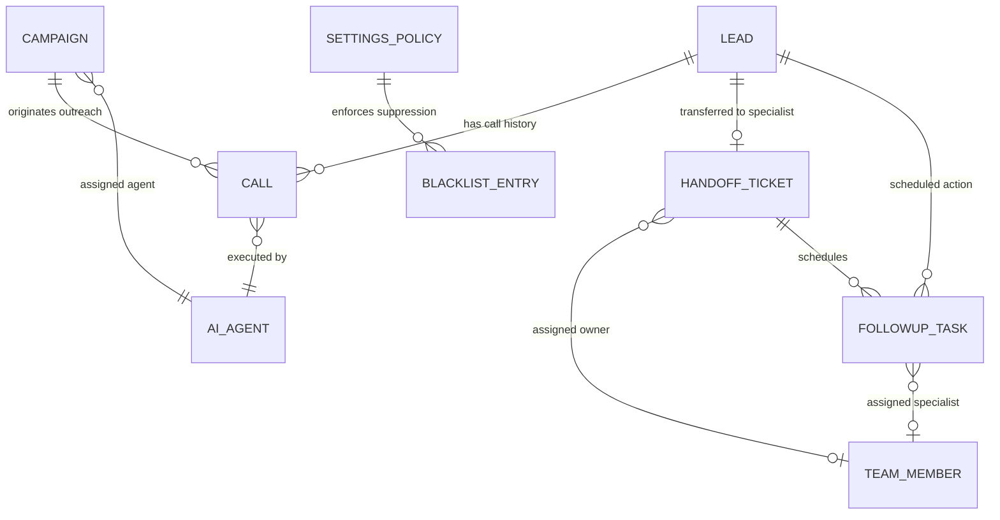
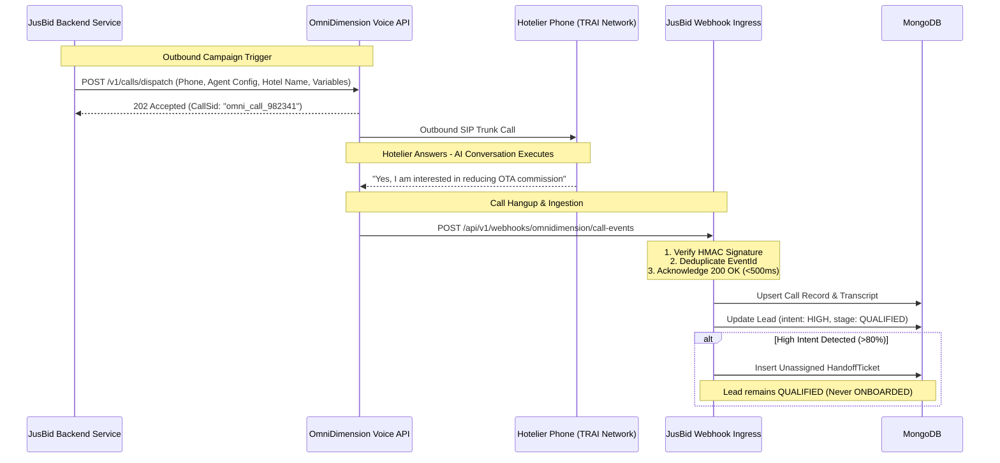

# JusBid AI Sales Agency — Backend Architecture & Requirements Specification

**Document Version:** 1.0.0  
**Date:** October 31, 2026  
**Author:** Senior Backend Architect & Systems Engineer  
**Project:** JusBid AI Sales Agency  
**Target Repository:** `D:\JusBid\Jusbid ai sales agent`  
**Status:** Read-Only Analysis & Backend Blueprint (Awaiting Approval)  

---

## 1. Executive Summary & Audit Baseline

A comprehensive, read-only architectural analysis of the **JusBid AI Sales Agency** repository was executed across:
* `package.json` and client dependencies.
* Frontend domain entity types in `src/types/index.ts`.
* Centralized state and data mutations in `src/context/mock-data-context.tsx`.
* Mock data structures in `src/data/mock/` (`leads.ts`, `campaigns.ts`, `agents.ts`, `calls.ts`, `handoffs.ts`, `followups.ts`, `team.ts`, `settings.ts`, `overview.ts`).
* All 14 page route implementations in `src/pages/`.
* Integration readiness analysis in `docs/integration-readiness.md`.

### Confirmed Architectural Facts
1. **Frontend Isolation:** The frontend operates completely in-browser using React 19, Vite, Tailwind CSS v4, and Radix UI / shadcn/ui primitives.
2. **Zero Network Calls:** The codebase contains 0 calls to `fetch()`, `axios`, `WebSocket`, `XMLHttpRequest`, or `EventSource`.
3. **Zero Database Connections:** No database drivers (`mongodb`, `mongoose`, `prisma`, `pg`) or connection strings currently exist in the repository.
4. **Centralized Data Hub:** All UI data dependencies flow through `MockDataProvider`. Replacing this provider with a service client layer will connect all 14 pages without altering UI component JSX.

---

## 2. Identification of Demo-Only & Simulated Data

Before defining production schemas, the following fields and structures currently in the frontend are classified as **strictly demo-only presentation artifacts** and should **not** become production database columns:

| Frontend Property / Field | Current Mock Usage | Production Backend Treatment |
| :--- | :--- | :--- |
| `isSimulatedDemo` | Present on `Campaign`, `Call`, `HandoffItem`, `FollowupItem`. | **Omit from production schema** or replace with an environment indicator (`environment: 'sandbox' \| 'production'`). |
| `isDemoPlaceholder` | Present on `AgentProviderConfig`. | **Omit**. Production provider configurations are managed via secure backend secrets. |
| UI Presentation Fields (`color`, `initials`, `avatarColor`) | Present on `Lead`, `TeamMember`, `HandoffItem`. | **Do not store in DB**. These are visual presentation helpers derived dynamically on the frontend. |
| Relative Time Strings (`age: '14 min ago'`, `time: 'Just now'`, `lastContact: 'Today, 10:42 AM'`) | Used for rapid rendering in mock cards. | **Replace with ISO 8601 timestamps** (`createdAt`, `updatedAt`, `lastContactedAt`, `scheduledAt`, `completedAt`). |
| Simulated Audio Scrubber & Player Controls | Simulated playback in `CallDetailsPage` and `AiAgentsPage`. | **Replace with real media pointers**: S3/GCS presigned audio recording URL (`audioRecordingUrl`). |
| Diagnostic Telemetry Placeholders (`sttConfidence: '98.4%'`, `packetLoss: '0.0%'`, `sipCode: 200`, `latencyMs: 215`) | Mock diagnostics on `CallTechnicalStatus`. | **Extract from real WebRTC/SIP webhook headers** emitted by OmniDimension. |
| Static Masked Integration Tokens (`maskedToken: '••••••••'`) | Present in `SettingsPage` `MOCK_INTEGRATIONS`. | **Never store or return to browser**. Real API keys must remain inside backend environment vaults (e.g. `.env` or KMS). |
| Static Aggregation Metrics on Models (`avgSpeed: '2.8 days'`, `rate: 38.9%`) | Pre-computed static mock stats on `TeamMember`. | **Compute dynamically** via backend MongoDB aggregation pipelines (`$group`, `$facet`). |

---

## 3. Required Backend Entities

The backend must model 8 primary domain entities:



### 3.1 `Lead` (Hotelier Property Prospect)
* **Identity & Contact:** `_id`, `hotelName`, `contactPersonName`, `designation`, `primaryPhone` (E.164 format, indexed), `primaryEmail`, `location` (city, state, address, geo coordinates).
* **Hotel Inventory:** `roomCount` (integer), `averageDailyRate` (decimal/integer), `currentOtaCommissionRate` (e.g., 22%), `pmsSystem` (e.g., IDS Next, Cloudbeds, ShawMan, Opera, None).
* **Pipeline & Intent:** `pipelineStage` (`NEW`, `CONTACTED`, `INTERESTED`, `QUALIFIED`, `ONBOARDED`, `DISQUALIFIED`), `intentClassification` (`HIGH`, `MEDIUM`, `LOW`, `UNDECIDED`), `fitScore` (0–100), `acquisitionSource`.
* **Relational Links:** `assignedCampaignId`, `assignedAgentId`, `activeHandoffId`, `createdAt`, `updatedAt`, `lastContactedAt`.

### 3.2 `Campaign` (Outreach Calling Blitz)
* **Metadata:** `_id`, `name`, `description`, `status` (`DRAFT`, `SCHEDULED`, `ACTIVE`, `PAUSED`, `COMPLETED`).
* **Targeting Criteria:** `targetRegions` (array of states/cities), `minRooms`, `maxRooms`, `targetAudienceDescription`.
* **Dialer Configuration:** `assignedAgentId`, `callingHours` (start/end window), `callingDays` (array of integers 0–6), `maxAttemptsPerLead`, `retryIntervalHours`, `suppressionRuleIds`.
* **Aggregated Performance:** `totalLeadsCount`, `callsAttempted`, `callsConnected`, `leadsQualified`, `interestedCount`.

### 3.3 `AiVoiceAgent` (OmniDimension Persona Profile)
* **Identity:** `_id`, `name` (Ava, Aria, Dev), `role`, `purposeDescription`, `status` (`ACTIVE`, `INACTIVE`, `TESTING`).
* **Prompt Engineering Assets:** `systemPrompt`, `greetingPrompt`, `approvedElevatorPitch`, `objectionHandlingPrompt`, `faqRepository` (array of `{ question, answer, category }`).
* **Voice & Telephony Parameters:** `primaryLanguage`, `supportedLanguages`, `voiceModelId`, `voiceToneDescription`, `maxUnansweredTurns`, `escalationTriggers` (pricing bound breach, negative sentiment, demo request).
* **OmniDimension Identifiers:** `omnidimensionAgentId`, `telephonyTrunkId`.

### 3.4 `Call` (Voice Outreach Session)
* **Session Identification:** `_id`, `omnidimensionCallSid` (unique indexed external reference), `leadId`, `campaignId`, `agentId`, `direction` (`OUTBOUND`, `INBOUND`).
* **Call Execution:** `status` (`INITIATED`, `RINGING`, `CONNECTED`, `COMPLETED`, `FAILED`, `BUSY`, `NO_ANSWER`), `startedAt`, `endedAt`, `durationSeconds`.
* **AI Outcome & Intelligence:** `outcome` (`INTERESTED`, `QUALIFIED_LEAD`, `DEMO_BOOKED`, `CALLBACK_REQUESTED`, `VOICEMAIL_LEFT`, `NOT_INTERESTED`), `intentScore` (0–100), `interestClassification` (`HIGH`, `MEDIUM`, `LOW`, `UNRESPONSIVE`), `aiSynopsis`, `extractedNextAction`, `objectionsDetected` (array of strings).
* **Media & Transcript:** `audioRecordingUrl`, `transcript` (array of `{ turnId, speaker, text, timestampMs, confidence }`).
* **Telemetric Diagnostics:** `sttLatencyMs`, `llmLatencyMs`, `ttsLatencyMs`, `sipResponseCode`, `disconnectReason`.

### 3.5 `HandoffTicket` (Human Specialist Onboarding Lifecycle)
* **Tracking:** `_id`, `leadId`, `sourceCallId`, `assignedSpecialistId` (nullable), `priority` (`HIGH`, `MEDIUM`, `LOW`), `status` (`UNASSIGNED`, `ASSIGNED`, `CONTACTED`, `FOLLOW_UP_REQUIRED`, `COMPLETED`, `REJECTED`).
* **Triage Context:** `reason`, `callSummarySnapshot`, `requestedCallbackWindow`, `slaDueAt`.
* **Milestone Verification (Governance Gate):** Array of 5 milestones:
  1. `AI Voice Discovery Qualification` (automated)
  2. `Commercial Terms & Zero-Commission Demo` (requires human check)
  3. `Rate Floor Protection & Room Type Sync` (requires human check)
  4. `Legal Agreement & GST Documentation` (requires human check)
  5. `Human-Verified Go-Live Certification` (**mandatory human verification gate for onboarding**)
* **Sub-Documents:** `contactAttempts` (type, outcome, notes, timestamp, agentId), `internalNotes` (author, text, timestamp), `auditTrail` (action, description, actorId, timestamp).

### 3.6 `FollowupTask` (Scheduled Specialist Action)
* **Details:** `_id`, `leadId`, `handoffId`, `assignedSpecialistId`, `taskType` (`DEMO_WALKTHROUGH`, `CALLBACK`, `CONTRACT_REVIEW`, `PMS_SYNC`).
* **Schedule:** `scheduledAt` (ISO timestamp), `preferredTimeWindow`, `priority`, `status` (`DUE`, `UPCOMING`, `OVERDUE`, `COMPLETED`, `CANCELLED`).
* **Outcome & Audit:** `reason`, `notes`, `completedAt`, `completionOutcome`.

### 3.7 `TeamMember` & System User
* **Profile:** `_id`, `fullName`, `email` (unique), `phone`, `role` (`ADMIN`, `SALES_DIRECTOR`, `SENIOR_ONBOARDING_SPECIALIST`, `INTEGRATION_LEAD`, `AUDITOR`), `accountStatus` (`ACTIVE`, `INVITED`, `SUSPENDED`).
* **Operational Load:** `focusSpecialization`, `assignedProperties` (array of property names/IDs), `passwordHash` (Argon2 / bcrypt), `lastLoginAt`.

### 3.8 `SettingsPolicy` & Compliance
* **Outreach Rules:** `callingHoursStart` (e.g. `'10:00'`), `callingHoursEnd` (e.g. `'18:30'`), `callingDays` (e.g. `[1, 2, 3, 4, 5, 6]`), `maxDailyDialsPerLead` (e.g. `2`), `coolOffPeriodDays` (e.g. `7`).
* **Claims Guardrails:** `approvedClaims` (array of `{ claim, category, source }`), `prohibitedClaims` (array of `{ claim, reason, riskLevel }`).
* **Suppression Blacklist:** Collection of `{ phone, propertyName, reason, addedByUserId, status: 'PERMANENT' | '90_DAY_COOLDOWN', expiresAt }`.

---

## 4. Core Business Rules to Enforce at Backend Level

1. **The Non-Negotiable Human Certification Gate:**
   * When an AI call outcome updates to `INTERESTED` or `QUALIFIED_LEAD`, the backend **must only** transition the lead stage to `QUALIFIED`.
   * The backend **must reject** any attempt by OmniDimension webhooks or automated scripts to mark a lead's stage as `ONBOARDED`.
   * A lead stage can **only** transition to `ONBOARDED` via an authorized specialist executing `POST /api/v1/handoffs/:id/certify`, verifying:
     - All 5 checklist milestones are checked.
     - GST and commercial agreement flags are validated.
     - The actor possesses the `SENIOR_ONBOARDING_SPECIALIST` or `ADMIN` role.
2. **TRAI & Calling Hours Regulatory Suppression:**
   * Before any automated call is dispatched to OmniDimension, the backend queue worker must verify:
     - Current India Standard Time (IST) is within `callingHoursStart` and `callingHoursEnd`.
     - The target phone number does not match an unexpired entry in the `Blacklist` collection.
     - The lead has not exceeded `maxDailyDialsPerLead`.
3. **Idempotent Single-Active-Handoff Rule:**
   * A hotelier lead cannot have multiple concurrently open `HandoffTicket` records. If an uncompleted ticket exists, subsequent AI qualification events append to the existing ticket's activity log instead of spawning duplicates.
4. **Specialist Performance Ledger Consistency:**
   * When a handoff ticket transitions to `COMPLETED`:
     - The assigned specialist's `closed` deal counter increments atomically.
     - The property is finalized in their historical deals registry.
     - The lead's audit trail is permanently appended.

---

## 5. Required API Operations

```
/api/v1/
 ├── auth/
 │    ├── POST   /login                       -> Authenticates operator, issues JWT / session
 │    ├── GET    /me                          -> Returns current authenticated user profile
 │    └── POST   /logout                      -> Invalidates token / clears session cookie
 │
 ├── leads/
 │    ├── GET    /                            -> Paginated leads list (filtering by stage, score, search)
 │    ├── POST   /                            -> Manually creates prospective hotelier lead
 │    ├── GET    /:id                         -> Retrieves single lead with linked call & handoff IDs
 │    ├── PATCH  /:id                         -> Updates lead profile (room count, contact name, etc.)
 │    └── DELETE /:id                         -> Soft-deletes / archives lead record
 │
 ├── campaigns/
 │    ├── GET    /                            -> Lists all outreach blitz campaigns
 │    ├── POST   /                            -> Creates campaign with scheduling & region criteria
 │    ├── GET    /:id                         -> Campaign details + performance breakdown
 │    ├── PATCH  /:id                         -> Updates schedule or target criteria
 │    ├── POST   /:id/launch                  -> Triggers outbound batch execution
 │    └── POST   /:id/pause                   -> Halts active dialer queue for campaign
 │
 ├── agents/
 │    ├── GET    /                            -> Lists AI Voice Agents (Ava, Aria, Dev)
 │    ├── GET    /:id                         -> Agent prompts, FAQs, voice params
 │    ├── PUT    /:id                         -> Updates prompt guidelines & escalation rules
 │    └── POST   /:id/test                    -> Runs synthetic diagnostic test against voice trunk
 │
 ├── calls/
 │    ├── GET    /                            -> Paginated call logs (filter by outcome, agent, date)
 │    ├── GET    /:id                         -> Full transcript turns, audio recording URL, objections
 │    └── PATCH  /:id/outcome                 -> Supervisor override for simulated/manual outcome
 │
 ├── handoffs/
 │    ├── GET    /                            -> Handoff queue items (filter: unassigned, assigned, etc.)
 │    ├── POST   /                            -> Creates handoff ticket (e.g. from qualified call)
 │    ├── GET    /:id                         -> Onboarding ticket: checklist, attempts, notes, audit
 │    ├── PATCH  /:id                         -> General ticket update
 │    ├── POST   /:id/reassign                -> Reassigns ticket owner & updates team load
 │    ├── POST   /:id/notes                   -> Adds specialist note to ticket
 │    ├── POST   /:id/contact-attempts        -> Logs manual phone/WhatsApp/demo outreach
 │    ├── POST   /:id/milestones/:mId/toggle  -> Toggles checklist milestone
 │    └── POST   /:id/certify                 -> [GOVERNANCE GATE] Final human sign-off -> ONBOARDED
 │
 ├── followups/
 │    ├── GET    /                            -> Lists tasks (filter by status: due, upcoming, overdue)
 │    ├── POST   /                            -> Schedules demo or callback task
 │    ├── POST   /:id/reschedule              -> Reschedules date/window with reason
 │    └── POST   /:id/complete                -> Closes task with completion outcome
 │
 ├── team/
 │    ├── GET    /                            -> Team roster with calculated load, close rate, active deals
 │    ├── POST   /invite                      -> Invites new specialist or admin user
 │    └── PATCH  /:id                         -> Updates team member status or specialization
 │
 ├── analytics/
 │    ├── GET    /overview                    -> Aggregates 6 core pipeline KPIs
 │    ├── GET    /funnel                      -> Conversion funnel (Dials -> Connects -> Qualified -> Certified)
 │    └── GET    /trends                      -> Time-series trend data points (7d, 14d, 30d)
 │
 ├── settings/
 │    ├── GET    /policies                    -> Calling hours, retry limits, approved claims
 │    ├── PUT    /policies                    -> Updates calling rules
 │    ├── GET    /blacklist                   -> Lists suppressed numbers
 │    ├── POST   /blacklist                   -> Adds phone number to suppression list
 │    └── DELETE /blacklist/:id               -> Removes phone number from blacklist
 │
 └── webhooks/
      ├── POST   /omnidimension/call-events   -> Ingests completed calls, transcripts, audio, intent
      └── POST   /omnidimension/call-status   -> Ingests live SIP status & WebRTC diagnostics
```

---

## 6. Authentication & Authorization (RBAC) Requirements

### 6.1 Authentication Mechanism
* **Stateless JWT with `HttpOnly` `SameSite=Strict` Cookie:** Recommended to eliminate frontend token storage and completely prevent XSS-based token exfiltration.
* **Header Alternative:** Standard `Authorization: Bearer <token>` support for server-to-server or programmatic access.

### 6.2 Role-Based Access Control Matrix

| System Role | Leads & Calls | Campaign Execution | Agent Prompts | Handoff & Checklist | Final Onboarding Certification | Settings & Blacklist |
| :--- | :---: | :---: | :---: | :---: | :---: | :---: |
| **`Admin`** | Full | Full | Full | Full | **Yes** | Full |
| **`Sales Director`** | Full | Full | View / Edit | Full | **Yes** | Read-Only |
| **`Senior Onboarding Specialist`** | Read / Edit | Read-Only | Read-Only | Full (Reassign, Notes) | **Yes** | Read-Only |
| **`Integration Lead`** | Read-Only | Read-Only | Read-Only | View / Notes | No | Integrations Only |
| **`Auditor`** | Read-Only | Read-Only | Read-Only | Read-Only | No | Read-Only |

---

## 7. MongoDB Architecture & Schema Considerations

MongoDB is an ideal persistence engine for this application due to:
* **Polymorphic Transcripts:** Conversational turns vary in length, metadata, speech confidence, and turn count.
* **Embedded Lifecycle Subdocuments:** Notes, contact attempts, milestone verifications, and audit logs are naturally bounded and always queried alongside the parent ticket.

### 7.1 Recommended Collection Schemas

```javascript
// 1. leads
{
  _id: ObjectId("..."),
  hotelName: "The Fern Residency",
  contactPersonName: "Ananya Mehta",
  designation: "General Manager",
  phone: "+919999900001",           // Indexed unique
  email: "ananya@fernresidency.in",
  city: "Jaipur",
  state: "Rajasthan",
  roomCount: 48,
  averageDailyRate: 4500,
  pipelineStage: "QUALIFIED",       // Indexed
  intentClassification: "HIGH",     // Indexed
  fitScore: 94,
  acquisitionSource: "North India Heritage Blitz",
  assignedCampaignId: ObjectId("..."),
  assignedAgentId: "agent-ava",
  createdAt: ISODate("2026-10-28T10:00:00Z"),
  updatedAt: ISODate("2026-10-28T10:45:00Z")
}

// 2. calls
{
  _id: ObjectId("..."),
  omnidimensionCallSid: "omni_call_982341", // Indexed unique
  leadId: ObjectId("..."),                   // Indexed
  campaignId: ObjectId("..."),               // Indexed
  agentId: "agent-ava",
  durationSeconds: 272,
  outcome: "INTERESTED",                     // Indexed
  intentScore: 94,
  interestClassification: "HIGH",
  aiSynopsis: "Operates 48 rooms in Jaipur. Pitch focused on 0% commission direct bidding...",
  objectionsDetected: ["Rate parity with OTAs", "PMS integration with IDS Next"],
  extractedNextAction: "Demo walkthrough scheduled with human specialist",
  audioRecordingUrl: "https://storage.jusbid.in/recordings/call-1.mp3",
  transcript: [                              // Embedded array
    { turnId: "t-1", speaker: "agent", text: "Hello, am I speaking with...", timestampMs: 1200 },
    { turnId: "t-2", speaker: "user", text: "Yes, this is Ananya...", timestampMs: 3400 }
  ],
  telemetry: {
    sttLatencyMs: 215,
    sipCode: 200,
    disconnectReason: "NORMAL_DISCONNECT"
  },
  createdAt: ISODate("2026-10-28T10:42:00Z")
}

// 3. handoff_tickets
{
  _id: ObjectId("..."),
  leadId: ObjectId("..."),                   // Indexed unique (for active status)
  sourceCallId: ObjectId("..."),
  assignedSpecialistId: ObjectId("..."),     // Indexed
  priority: "HIGH",                          // Indexed
  status: "ASSIGNED",                        // Indexed ('UNASSIGNED', 'ASSIGNED', 'CONTACTED', 'COMPLETED')
  reason: "Decision maker requested human demonstration of PMS sync and direct pricing floor",
  callSummarySnapshot: "Verified 48 keys in Jaipur. Pain point: 22% OTA commission.",
  requestedCallbackWindow: "Today, 2:00 PM - 3:00 PM IST",
  checklist: [                               // Embedded milestones
    { milestoneId: "chk-1", label: "AI Voice Qualification", completed: true, completedAt: ISODate("..."), completedBy: "agent-ava" },
    { milestoneId: "chk-2", label: "Commercial Terms Demo", completed: true, completedAt: ISODate("..."), completedBy: "Arjun Patel" },
    { milestoneId: "chk-3", label: "Rate Floor Calibration", completed: false },
    { milestoneId: "chk-4", label: "GST & Legal Agreement", completed: false },
    { milestoneId: "chk-5", label: "Human-Verified Certification", completed: false, requiresHumanVerification: true }
  ],
  contactAttempts: [                         // Embedded attempt log
    { attemptId: "att-1", type: "call", outcome: "Spoke with GM", notes: "Agreed to trial", timestamp: ISODate("...") }
  ],
  internalNotes: [                           // Embedded notes
    { noteId: "n-1", author: "Arjun Patel", text: "Sent proposal deck via email", createdAt: ISODate("...") }
  ],
  auditTrail: [                              // Immutable audit trail
    { action: "ASSIGNED", description: "Assigned to Arjun Patel", actorId: "user-admin", timestamp: ISODate("...") }
  ],
  createdAt: ISODate("2026-10-28T10:46:00Z"),
  updatedAt: ISODate("2026-10-28T11:00:00Z")
}
```

### 7.2 Essential Database Indexes
```javascript
db.leads.createIndex({ phone: 1 }, { unique: true });
db.leads.createIndex({ pipelineStage: 1, fitScore: -1 });
db.calls.createIndex({ omnidimensionCallSid: 1 }, { unique: true });
db.calls.createIndex({ leadId: 1, createdAt: -1 });
db.calls.createIndex({ outcome: 1 });
db.handoff_tickets.createIndex({ status: 1, priority: 1 });
db.handoff_tickets.createIndex({ assignedSpecialistId: 1 });
db.blacklist.createIndex({ phone: 1 }, { unique: true });
```

---

## 8. OmniDimension Integration & Webhook Architecture



### Inbound Webhook Requirements
1. **Signature Verification:** All incoming requests from OmniDimension must include an HMAC-SHA256 signature in the header (`X-OmniDimension-Signature`) computed with a shared secret.
2. **Fast Acknowledgment:** The webhook receiver must respond with HTTP `200 OK` within 1000ms. Heavy processing (transcript parsing, media bucket archiving) should execute via background workers.
3. **Idempotency:** Webhook requests must carry an `eventId` or `callSid`. Duplicated payloads must be recognized and dropped safely.

---

## 9. Frontend-to-Backend Integration Considerations

To connect the existing frontend cleanly:

1. **Anti-Corruption Layer (ACL):**
   * The backend should expose clean JSON contracts matching frontend models where practical, but the frontend should implement DTO transformers (`toFrontendLead`, `toFrontendCall`, `toFrontendHandoff`) so internal database column names (`hotel_name` vs `property`) never break page components.
2. **Server-Side Pagination:**
   * In production with 10,000+ hoteliers, the frontend's current client-side filtering will be replaced by standard backend query parameters:
     `GET /api/v1/leads?page=1&limit=25&stage=QUALIFIED&search=jaipur`
3. **Real-Time Queue Alerts (Server-Sent Events / SSE):**
   * When OmniDimension finishes a call and an unassigned handoff is created, human onboarding specialists should see the handoff ticket appear in `/handoffs` without a manual page refresh.
   * An SSE stream (`GET /api/v1/events/stream`) is recommended over complex WebSockets for unidirectional live feed updates.

---

## 10. Missing Information & Unknowns Requiring Confirmation

Before writing backend code, the following architectural decisions require confirmation:

| # | Unknown Dimension | Question to Confirm |
| :---: | :--- | :--- |
| **1** | **Backend Stack** | What is the preferred backend runtime and framework? (e.g., **Node.js with TypeScript / Express / Fastify / NestJS**, or **Python with FastAPI**?) |
| **2** | **Database Instance** | Is there an existing MongoDB cluster (e.g. MongoDB Atlas) ready to connect, or will this be a newly initialized database? |
| **3** | **Existing JusBid Schemas** | Is there an existing JusBid user/hotel database schema that the sales agent must join with or cross-reference? |
| **4** | **OmniDimension API Specs** | Are the official OmniDimension API documentation, endpoint URLs, and webhook sample payloads available? |
| **5** | **Audio Media Storage** | Does OmniDimension host call audio recordings permanently, or must the backend stream them to an S3/Cloudflare R2 bucket? |
| **6** | **Authentication System** | Does JusBid use an existing Single Sign-On (SSO) gateway (e.g., Firebase Auth, Auth0, Keycloak, or custom JWT)? |

---

## 11. Proposed Phased Backend Implementation Plan

```
[Phase 1: Architecture & Server Foundation]
 ├── Setup Node.js/TypeScript backend project (src/server.ts, config, logger)
 ├── Configure MongoDB connection via Mongoose with clean connection pooling
 └── Implement global error handler, request validator, and security middleware (Helmet, CORS)

[Phase 2: Database Models & Schemas]
 ├── Implement Mongoose schemas: Lead, Campaign, AiAgent, Call, HandoffTicket, FollowupTask, TeamMember, Blacklist
 └── Create automated seed script matching the frontend's 24 leads, 4 team members, and voice fleet

[Phase 3: Core API Services & Controllers]
 ├── Implement Leads & Calls CRUD controllers
 ├── Implement Handoff Queue, specialist assignment, and milestone checklist endpoints
 ├── Enforce Human Certification governance gate in the handoff service
 └── Implement Follow-up tasks and Team roster management endpoints

[Phase 4: OmniDimension Gateway & Webhooks]
 ├── Implement HMAC-verified webhook endpoint for call completion and transcript ingestion
 ├── Implement automated handoff ticket spawning on high-intent calls
 └── Implement outbound campaign dispatcher simulation / adapter

[Phase 5: Frontend Integration & Verification]
 ├── Configure Vite dev proxy (or CORS) to forward requests from port 5178 to backend
 ├── Replace mock context state with real HTTP service adapter
 └── Test the complete 7-step lead-to-onboarded workflow end-to-end
```

