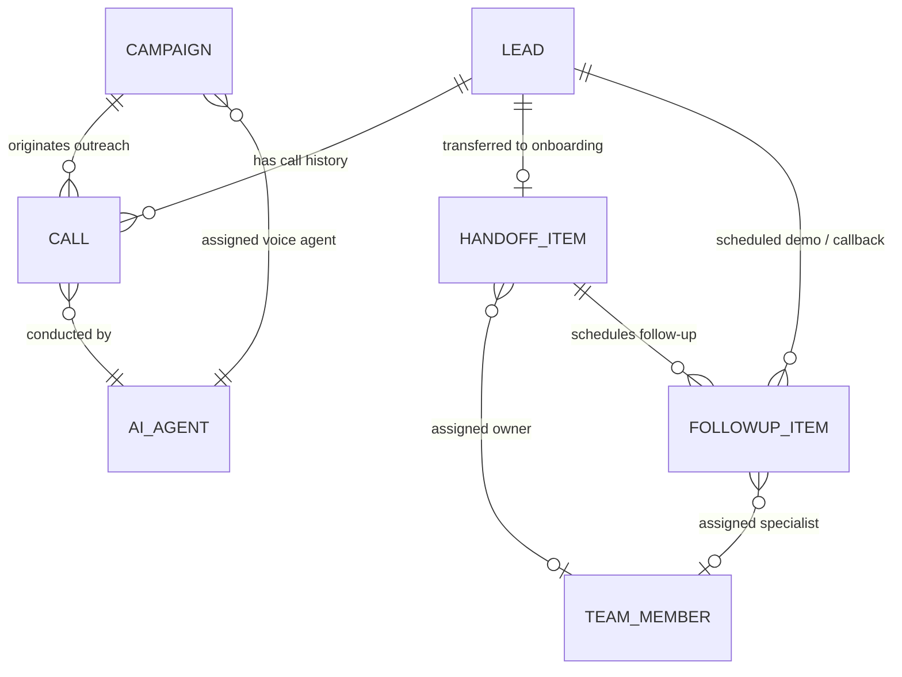
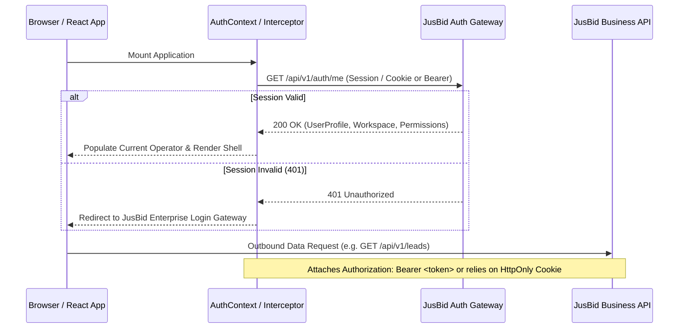
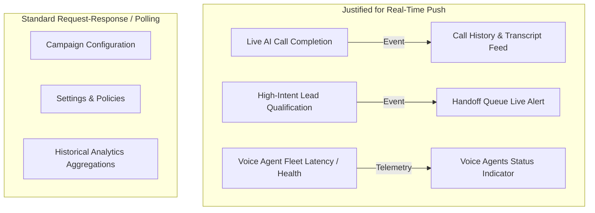

# JusBid AI Sales Agency — Integration Architecture Readiness Review

**Document Version:** 1.0.0  
**Date:** October 31, 2026  
**Auditor / Roles:** Senior Software Architect & Backend Integration Engineer  
**Target Repository:** `jusbid-ai-sales-agent`  
**Target Document Path:** `docs/integration-readiness.md`  

---

## Executive Summary

The frontend development of the **JusBid AI Sales Agency** dashboard is complete and operational in a zero-network, mock-backed sandbox environment. The user interface models the complete lifecycle of autonomous AI hotelier outreach, intent classification, qualified lead handoff, human specialist allocation, callback task management, and human-certified onboarding.

This document provides a comprehensive readiness review and architectural roadmap for integrating this frontend with an existing business backend. 

In strict adherence to project constraints:
- **No changes were made to existing frontend application code.**
- **No API endpoints or database connections were created.**
- **No speculative backend infrastructure (e.g., PostgreSQL, Redis, AWS KMS, Meta WABA) is assumed.**
- All content clearly distinguishes **Confirmed Frontend Facts**, **Proposed Integration Architecture**, and **Unknown Backend Requirements**.

---

## 1. Current Frontend Architecture

### 1.1 Technology Stack & Core Dependencies
* **Core Framework:** React 19 (`react` `^19.1.0`, `react-dom` `^19.1.0`)
* **Build Tooling:** Vite 6 (`vite` `^6.3.5`, `@vitejs/plugin-react` `^4.4.1`)
* **Language:** TypeScript 5 (`typescript` `~5.8.3`) in strict mode with zero compilation errors (`tsc -b`)
* **Routing:** React Router v7 (`react-router-dom` `^7.18.5`) using HTML5 History API (`BrowserRouter`)
* **Styling & Components:** Tailwind CSS v4 (`@tailwindcss/vite` `^4.3.3`, `tailwindcss` `^4.3.3`), Radix UI primitives (`radix-ui` `^1.8.1`), Class Variance Authority (`class-variance-authority` `^0.7.1`), `clsx` (`^2.1.1`), `tailwind-merge` (`^3.7.0`)
* **Icons:** Lucide React (`lucide-react` `^1.62.0`)
* **Code Quality:** ESLint 9 (`eslint` `^9.25.0`) with React Hooks and Fast Refresh rules (0 errors, 0 warnings)

### 1.2 Component Tree & Runtime Topology
```
index.html
 └── main.tsx
      └── <StrictMode>
           └── <ErrorBoundary>                (Graceful fallback, error recovery)
                └── <BrowserRouter>            (HTML5 pushState / replaceState)
                     └── <MockDataProvider>   (Centralized state & derived metrics)
                          └── <Routes>
                               └── <Route element={<AppShell />}>
                                    ├── <Route path="/" element={<Navigate to="/overview" replace />} />
                                    ├── <Route path="/overview" element={<OverviewPage />} />
                                    ├── <Route path="/leads" element={<LeadsPage />} />
                                    ├── <Route path="/leads/:leadId" element={<LeadDetailsPage />} />
                                    ├── <Route path="/campaigns" element={<CampaignsPage />} />
                                    ├── <Route path="/agents" element={<AiAgentsPage />} />
                                    ├── <Route path="/calls" element={<CallHistoryPage />} />
                                    ├── <Route path="/calls/:callId" element={<CallDetailsPage />} />
                                    ├── <Route path="/handoffs" element={<HandoffQueuePage />} />
                                    ├── <Route path="/onboarding/:id" element={<OnboardingDetailsPage />} />
                                    ├── <Route path="/followups" element={<FollowupsPage />} />
                                    ├── <Route path="/team" element={<TeamPage />} />
                                    ├── <Route path="/analytics" element={<AnalyticsPage />} />
                                    ├── <Route path="/settings" element={<SettingsPage />} />
                                    └── <Route path="*" element={<NotFoundPage />} />
```

### 1.3 State Management & Persistence Baseline
* **Central Provider:** [`MockDataProvider`](file:///d:/JusBid/Jusbid%20ai%20sales%20agent/src/context/mock-data-context.tsx) wraps the entire route tree. It manages 7 master entity collections in memory and computes 17 real-time derived pipeline metrics.
* **Storage Isolation:**
  * `sessionStorage`: Keyed by `jusbid_demo_data_v1_*` (e.g. `leads`, `calls`, `handoffs`). Allows F5 browser refreshes without losing simulated changes during a demo session. Falls back safely to in-memory state if `sessionStorage` is blocked.
  * `localStorage`: Strictly stores a single boolean preference (`jusbid_sidebar_collapsed`).
* **Zero Network Calls:** The codebase contains 0 calls to `fetch()`, `axios`, `WebSocket`, `XMLHttpRequest`, or `EventSource`.

---

## 2. Frontend Entities and Relationships

### 2.1 Entity Relationship Diagram


### 2.2 Entity Schema Specifications

#### 1. Lead (`Lead`) — [`src/types/index.ts#L17-L39`](file:///d:/JusBid/Jusbid%20ai%20sales%20agent/src/types/index.ts#L17-L39)
Represents a prospective hotelier.
* **Fields:** `id` (PK, string), `name` (string), `property` (string), `location` (string), `city` (string), `state` (string), `initials` (string), `color` (string), `score` (number, 0-100), `status` (string: `'New'` | `'Contacted'` | `'Interested'` | `'Qualified'` | `'Onboarded'`), `interest` (`'High'` | `'Medium'` | `'Low'` | `'Undecided'`), `source` (string), `lastContact` (string), `phone` (string), `email` (string), `rooms` (number), `adr` (string, optional), `notes` (string, optional), `createdAt` (string, optional), `assignedCampaignId` (FK, optional), `assignedAgentId` (FK, optional).

#### 2. Campaign (`Campaign`) — [`src/types/index.ts#L43-L63`](file:///d:/JusBid/Jusbid%20ai%20sales%20agent/src/types/index.ts#L43-L63)
Represents an autonomous AI voice outreach blitz.
* **Fields:** `id` (PK, string), `name` (string), `description` (string), `status` (`'active'` | `'scheduled'` | `'paused'` | `'completed'` | `'draft'`), `targetAudience` (string), `targetRegion` (string[]), `audienceSize` (number), `callsAttempted` (number), `callsConnected` (number), `leadsQualified` (number), `interestRate` (number), `assignedAgentId` (FK, string), `assignedAgentName` (string), `scheduleWindow` (string), `scheduleDays` (string[]), `maxAttemptsPerLead` (number), `suppressionRules` (string[]), `createdAt` (string), `isSimulatedDemo` (boolean).

#### 3. AI Agent (`AiAgent`) — [`src/types/index.ts#L135-L155`](file:///d:/JusBid/Jusbid%20ai%20sales%20agent/src/types/index.ts#L135-L155)
Represents an autonomous voice caller persona (Ava, Aria, Dev).
* **Fields:** `id` (PK, string), `name` (string), `role` (string), `purpose` (string), `language` (string), `supportedLanguages` (string[]), `voiceTone` (string), `isEnabled` (boolean), `lastTestStatus` (`'Passed'` | `'Degraded'` | `'Pending'`), `lastTestedAt` (string), `testLatencyMs` (number), `callsCount` (number), `qualificationRate` (number), `avgDuration` (string), `greetingPrompt` (string), `approvedPitch` (string), `faqs` (`AgentFaq[]`), `escalation` (`AgentEscalationConfig`), `provider` (`AgentProviderConfig`).

#### 4. Call Record (`Call`) — [`src/types/index.ts#L84-L109`](file:///d:/JusBid/Jusbid%20ai%20sales%20agent/src/types/index.ts#L84-L109)
Represents an outbound or inbound voice conversation.
* **Fields:** `id` (PK, string), `leadId` (FK, string, optional), `name` (string), `property` (string), `city` (string), `phone` (string), `time` (string), `date` (string), `duration` (string), `durationSeconds` (number), `outcome` (string: `'Interested'` | `'Qualified Lead'` | `'Demo booked'` | `'Callback requested'` | `'Voicemail left'` | `'Not interested'`), `agent` (string), `agentId` (FK, string), `campaign` (string), `campaignId` (FK, string), `interestClassification` (`'High'` | `'Medium'` | `'Low'` | `'Unresponsive'`), `intentScore` (number, 0-100), `tone` (string), `aiSummary` (string), `objections` (string[]), `extractedNextAction` (string), `technicalStatus` (`CallTechnicalStatus`), `transcript` (`CallTranscriptTurn[]`), `isSimulatedDemo` (boolean).

#### 5. Onboarding Handoff Item (`HandoffItem`) — [`src/types/index.ts#L199-L227`](file:///d:/JusBid/Jusbid%20ai%20sales%20agent/src/types/index.ts#L199-L227)
Represents a qualified hotelier prospect transferred to human sales/onboarding.
* **Fields:** `id` (PK, string), `leadId` (FK, string, optional), `callId` (FK, string, optional), `name` (string), `property` (string), `city` (string), `phone` (string), `rooms` (number), `reason` (string), `callSummary` (string), `interestLevel` (`'High'` | `'Medium'` | `'Low'`), `requestedCallbackWindow` (string), `assignedAgentId` (FK, string | null), `assignedAgent` (string | null), `assignedAgentRole` (string, optional), `priority` (`'High'` | `'Medium'` | `'Low'`), `status` (`HandoffStatus`: `'unassigned'` | `'assigned'` | `'contacted'` | `'follow-up required'` | `'completed'`), `age` (string), `time` (string), `initials` (string), `color` (string), `notes` (`HandoffNote[]`), `checklist` (`OnboardingMilestone[]`), `contactAttempts` (`ContactAttempt[]`), `activityLog` (`OnboardingActivity[]`), `createdAt` (string), `isSimulatedDemo` (boolean).

#### 6. Follow-up Task (`FollowupItem`) — [`src/types/index.ts#L231-L256`](file:///d:/JusBid/Jusbid%20ai%20sales%20agent/src/types/index.ts#L231-L256)
Represents a scheduled human callback, demo session, or contract review.
* **Fields:** `id` (PK, string), `leadId` (FK, string, optional), `handoffId` (FK, string, optional), `assignedAgentId` (FK, string, optional), `name` (string), `property` (string), `city` (string), `phone` (string), `assignedAgent` (string), `preferredCallbackWindow` (string), `scheduledDate` (string), `scheduledTime` (string), `reason` (string), `priority` (`'High'` | `'Medium'` | `'Low'`), `status` (`'due'` | `'upcoming'` | `'overdue'` | `'completed'` | `'cancelled'`), `taskType` (string), `initials` (string), `color` (string), `notes` (string, optional), `completedAt` (string, optional), `completionOutcome` (string, optional), `time` (string), `type` (string), `isSimulatedDemo` (boolean).

#### 7. Human Team Member (`TeamMember`) — [`src/types/index.ts#L258-L274`](file:///d:/JusBid/Jusbid%20ai%20sales%20agent/src/types/index.ts#L258-L274)
Represents a human sales specialist or onboarding agent.
* **Fields:** `id` (PK, string), `name` (string), `role` (string), `email` (string), `phone` (string), `initials` (string), `color` (string), `assigned` (number), `inProgress` (number, optional), `closed` (number), `rate` (number, qualification-to-close %), `status` (string: `'Online'` | `'In a call'` | `'Offline'`), `focus` (string, optional), `avgSpeed` (string, optional), `assignedProperties` (string[], optional).

---

## 3. Existing Mock-Data Mutation Functions

All frontend state mutations are isolated inside [`src/context/mock-data-context.tsx`](file:///d:/JusBid/Jusbid%20ai%20sales%20agent/src/context/mock-data-context.tsx). These form the exact specification for future backend API operations:

| Mutation Function | Signature | Current Frontend Behavior | Future Backend Operation |
| :--- | :--- | :--- | :--- |
| **`updateLead`** | `(id: string, updates: Partial<Lead>) => void` | Mutates lead in local state array. | `PATCH /api/v1/leads/:id` |
| **`addLead`** | `(newLead: Lead) => void` | Prepends lead to local array. | `POST /api/v1/leads` |
| **`deleteLead`** | `(id: string) => void` | Filters out lead by ID. | `DELETE /api/v1/leads/:id` |
| **`updateCampaign`** | `(id: string, updates: Partial<Campaign>) => void` | Updates campaign status/schedule. | `PATCH /api/v1/campaigns/:id` |
| **`addCampaign`** | `(campaign: Campaign) => void` | Prepends new campaign. | `POST /api/v1/campaigns` |
| **`updateAgent`** | `(id: string, updates: Partial<AiAgent>) => void` | Updates prompt/voice configuration. | `PUT /api/v1/agents/:id` |
| **`updateCall`** | `(id: string, updates: Partial<Call>) => void` | Updates call outcome and syncs linked lead interest/score. Enforces non-onboarding rule. | `PATCH /api/v1/calls/:id` |
| **`addCall`** | `(call: Call) => void` | Appends call to log. | `POST /api/v1/calls` |
| **`addHandoff`** | `(handoff: HandoffItem) => void` | Creates handoff ticket; links lead status to Qualified; updates specialist count. | `POST /api/v1/handoffs` |
| **`updateHandoff`** | `(id: string, updates: Partial<HandoffItem>) => void` | Updates ticket; if `status === 'completed'`, marks linked lead `'Onboarded'` and increments specialist `closed`. | `PATCH /api/v1/handoffs/:id` |
| **`reassignHandoff`** | `(id: string, name: string, role?: string, id?: string) => void` | Reassigns ticket owner, status to `'assigned'`, appends property to specialist deals, logs activity. | `POST /api/v1/handoffs/:id/reassign` |
| **`addHandoffNote`** | `(id: string, noteText: string, author?: string) => void` | Prepends note to ticket and appends to activity log. | `POST /api/v1/handoffs/:id/notes` |
| **`logContactAttempt`**| `(id: string, attempt: Omit<ContactAttempt, 'id'>) => void` | Logs specialist call/email/demo, transitions status to `'contacted'`. | `POST /api/v1/handoffs/:id/contact-attempts` |
| **`toggleChecklistMilestone`** | `(id: string, milestoneId: string, completedBy?: string) => void` | Toggles milestone. If final milestone confirmed, triggers lead `'Onboarded'`. | `POST /api/v1/handoffs/:id/milestones/:mId/toggle` |
| **`updateFollowup`** | `(id: string, updates: Partial<FollowupItem>) => void` | Updates follow-up record. | `PATCH /api/v1/followups/:id` |
| **`rescheduleFollowup`** | `(id: string, date: string, window: string, reason: string) => void` | Sets status to `'upcoming'` with new date/window. | `POST /api/v1/followups/:id/reschedule` |
| **`completeFollowup`** | `(id: string, outcome: string) => void` | Sets status to `'completed'` with timestamp and outcome. | `POST /api/v1/followups/:id/complete` |
| **`addFollowup`** | `(task: FollowupItem) => void` | Adds task to follow-up schedule. | `POST /api/v1/followups` |
| **`updateTeamMember`**| `(id: string, updates: Partial<TeamMember>) => void` | Updates specialist attributes. | `PATCH /api/v1/team/:id` |
| **`addTeamMember`** | `(member: TeamMember) => void` | Adds team member to roster. | `POST /api/v1/team` |
| **`resetAllMockData`** | `() => void` | Clears `sessionStorage` and restores initial mock datasets. | Dev / Sandbox utility |

---

## 4. Frontend Data Dependencies by Page

| Page Route | React Component | Read Dependencies (`useMockData`) | Mutation Dependencies (`useMockData`) | Static / Local Fixtures |
| :--- | :--- | :--- | :--- | :--- |
| **`/overview`** | `OverviewPage` | `calls`, `handoffs`, `derivedMetrics` | None | `OVERVIEW_METRICS`, `CALL_ACTIVITY_14_DAYS` |
| **`/leads`** | `LeadsPage` | `leads` | `addLead` | Local search/filter state |
| **`/leads/:leadId`** | `LeadDetailsPage` | `leads`, `calls`, `handoffs` | `addFollowup`, `addCall` | Local modal states (proposal, demo) |
| **`/campaigns`** | `CampaignsPage` | `campaigns`, `agents` | `addCampaign`, `updateCampaign` | Local campaign wizard state |
| **`/agents`** | `AiAgentsPage` | `agents` | `updateAgent` | Local test runner state |
| **`/calls`** | `CallHistoryPage` | `calls` | None | Local audio player state, filter state |
| **`/calls/:callId`** | `CallDetailsPage` | `calls`, `handoffs`, `leads`, `teamMembers` | `updateCall`, `addHandoff` | Local playback, outcome change dialog |
| **`/handoffs`** | `HandoffQueuePage` | `handoffs`, `teamMembers` | `reassignHandoff`, `addHandoffNote`, `updateHandoff` | Local tab & note modals |
| **`/onboarding/:id`** | `OnboardingDetailsPage`| `handoffs`, `teamMembers` | `updateHandoff`, `reassignHandoff`, `addHandoffNote`, `logContactAttempt`, `toggleChecklistMilestone`, `addFollowup` | Local contact attempt, reassign & certification modals |
| **`/followups`** | `FollowupsPage` | `followups`, `teamMembers` | `updateFollowup`, `rescheduleFollowup`, `completeFollowup`, `addFollowup` | Local reschedule/complete dialogs |
| **`/team`** | `TeamPage` | `teamMembers`, `handoffs` | `addTeamMember` | Local invite dialog |
| **`/analytics`** | `AnalyticsPage` | `derivedMetrics` | None | `CALL_ACTIVITY_14_DAYS`, `CAMPAIGN_SUMMARIES` |
| **`/settings`** | `SettingsPage` | None (currently isolated) | None (local React state) | `MOCK_SETTINGS_TEAM_MEMBERS`, `MOCK_PERMISSIONS_MATRIX`, `MOCK_APPROVED_CLAIMS`, `MOCK_INTEGRATIONS`, etc. |
| **Shell & Nav** | `AppShell`, `Sidebar`, `Topbar` | `leads`, `calls`, `campaigns` | None | `MOCK_OPERATOR`, `NAV_SECTIONS` |

---

## 5. Proposed API Service Architecture

### 5.1 Service Layer Boundary
To avoid touching existing UI components during integration, introduce a modular service layer between the React Context and the network.

```mermaid
flowchart LR
    UI[Page Components & Layouts]
    CTX[DataContext / Hooks Layer]
    ADAPT{Adapter Switch<br/>(MOCK vs HTTP)}
    MOCK[MockAdapter<br/>(sessionStorage fixtures)]
    HTTP[HttpAdapter<br/>(REST / JSON API)]
    BACKEND[(JusBid Business Backend)]

    UI --> CTX
    CTX --> ADAPT
    ADAPT -->|VITE_DATA_SOURCE=mock| MOCK
    ADAPT -->|VITE_DATA_SOURCE=api| HTTP
    HTTP --> BACKEND
```

### 5.2 Proposed Service Module Structure
```
src/
 ├── services/
 │    ├── api-client.ts          (Base HTTP client with interceptors & error normalization)
 │    ├── leads.service.ts       (fetchLeads, getLeadById, createLead, updateLead)
 │    ├── campaigns.service.ts   (fetchCampaigns, createCampaign, updateCampaignStatus)
 │    ├── agents.service.ts      (fetchAgents, updateAgentConfig, runAgentTest)
 │    ├── calls.service.ts       (fetchCalls, getCallById, updateCallOutcome)
 │    ├── handoffs.service.ts    (fetchHandoffs, createHandoff, reassign, addNote, logAttempt, verifyMilestone)
 │    ├── followups.service.ts   (fetchFollowups, createFollowup, reschedule, complete)
 │    ├── team.service.ts        (fetchTeamMembers, createTeamMember, updateCapacity)
 │    ├── analytics.service.ts   (fetchPipelineMetrics, fetchTrendSeries)
 │    └── settings.service.ts    (fetchPolicies, updateBlacklist, fetchIntegrations)
 ├── adapters/
 │    ├── mappers/               (Anti-Corruption Layer DTO transformers)
 │    └── types.ts               (Backend DTO contract definitions)
```

---

## 6. Proposed Authentication Integration Boundary

### 6.1 Current Fact
The frontend currently uses a static operator profile defined in [`src/layouts/navigation-data.ts#L169-L176`](file:///d:/JusBid/Jusbid%20ai%20sales%20agent/src/layouts/navigation-data.ts#L169-L176):
```ts
export const MOCK_OPERATOR: OperatorProfile = {
  name: 'Atul Sharma',
  role: 'Growth Sales Lead',
  email: 'atul.sharma@jusbid.in',
  initials: 'AS',
  status: 'online',
  workspace: 'JusBid Hospitality · Growth Suite',
}
```

### 6.2 Proposed Boundary Architecture


### 6.3 Security Principles
* **Zero Token Storage in LocalStorage:** Avoid storing raw JWT tokens in `localStorage` to eliminate XSS token-theft risks. Use secure `HttpOnly` `SameSite=Strict` cookies or in-memory access tokens with silent refresh.
* **Role-Based Capability Gating:** Map the backend user profile to the existing UI permissions matrix (`SettingsRolePermission`).

---

## 7. Proposed Backend-to-Frontend Data Mapping Strategy

### 7.1 Anti-Corruption Layer (ACL)
Because the existing JusBid backend likely uses different schemas, naming conventions (e.g. `snake_case`), or relational identifiers, an **Anti-Corruption Layer** must sit between HTTP responses and the frontend types.

```ts
// Example: src/adapters/mappers/lead.mapper.ts
export function toFrontendLead(dto: BackendLeadDto): Lead {
  return {
    id: String(dto.lead_id || dto.id),
    name: dto.contact_person_name || dto.name,
    property: dto.hotel_name || dto.property_name,
    location: `${dto.city}, ${dto.state}`,
    city: dto.city,
    state: dto.state,
    initials: getInitials(dto.contact_person_name || dto.hotel_name),
    color: mapScoreToColor(dto.fit_score),
    score: dto.fit_score ?? 70,
    status: mapBackendStageToLeadStatus(dto.pipeline_stage),
    interest: mapBackendInterest(dto.intent_level),
    source: dto.acquisition_source || 'AI Cold Outreach',
    lastContact: formatRelativeTime(dto.last_contacted_at),
    phone: dto.primary_phone,
    email: dto.primary_email,
    rooms: dto.total_room_count || 0,
    adr: dto.average_daily_rate ? `₹${dto.average_daily_rate.toLocaleString('en-IN')}` : undefined,
    notes: dto.internal_notes,
    assignedCampaignId: dto.campaign_id ? String(dto.campaign_id) : undefined,
    assignedAgentId: dto.agent_id ? String(dto.agent_id) : undefined,
  }
}
```

### 7.2 Human Onboarding Status Reconciliation
To protect the critical business rule (*AI interest alone never marks a hotelier as onboarded*), the mapper must enforce stage separation:

| Backend Lead State | Backend Onboarding Status | Frontend `Lead.status` | Frontend `Handoff.status` |
| :--- | :--- | :--- | :--- |
| `NEW` / `CONTACTED` | `NONE` | `'Contacted'` | N/A |
| `QUALIFIED` / `INTERESTED` | `PENDING_ASSIGNMENT` | `'Interested'` / `'Qualified'` | `'unassigned'` |
| `QUALIFIED` | `IN_DISCOVERY` | `'Qualified'` | `'assigned'` / `'contacted'` |
| `QUALIFIED` | `DEMO_SCHEDULED` | `'Qualified'` | `'follow-up required'` |
| `CONTRACT_SIGNED` | `CERTIFIED_ACTIVE` (Human verified) | **`'Onboarded'`** | **`'completed'`** |

---

## 8. Error and Loading State Strategy

### 8.1 Current Fact
* **Fatal Error Boundary:** The application is wrapped in [`ErrorBoundary`](file:///d:/JusBid/Jusbid%20ai%20sales%20agent/src/components/error-boundary.tsx), providing a recovery screen with "Reload Page" and "Return to Overview" buttons.
* **Empty States:** Missing or invalid URL IDs render standard `<EmptyState>` components across [`LeadDetailsPage`](file:///d:/JusBid/Jusbid%20ai%20sales%20agent/src/pages/lead-details.tsx#L63-L79), [`CallDetailsPage`](file:///d:/JusBid/Jusbid%20ai%20sales%20agent/src/pages/call-details.tsx#L94-L110), and [`OnboardingDetailsPage`](file:///d:/JusBid/Jusbid%20ai%20sales%20agent/src/pages/onboarding-details.tsx#L103-L121).

### 8.2 Proposed Integration Enhancements
1. **Asynchronous Query States:**
   Extend the data context interface to provide standardized query metadata:
   ```ts
   interface QueryState<T> {
     data: T
     isLoading: boolean
     isError: boolean
     error: ApiError | null
     refetch: () => Promise<void>
   }
   ```
2. **Skeleton Fallbacks:**
   Display subtle skeleton placeholders in KPI card grids and data tables during initial cold fetches without unmounting page layouts.
3. **Optimistic Updates with Automatic Rollback:**
   When reassigning a specialist or checking an onboarding milestone, apply the UI state optimistically. If the backend mutation fails (e.g. 500 error or network disconnect), revert the state and display a toast notification with a "Retry" button.

---

## 9. Real-Time Update Requirements (Justified)

Real-time synchronization is justified for specific modules of this dashboard to support live sales operations:



### Technical Recommendation:
* **Recommended Protocol:** **Server-Sent Events (SSE)** or **WebSocket**. SSE is preferred for the majority of the pipeline because the traffic is primarily server-to-client event streaming (call completed, transcript ready, hot lead queued) with standard HTTP POST/PATCH for client mutations.
* **Fallback:** Standard HTTP short polling (e.g., 15-30 second interval) if WebSocket/SSE connection fails or is restricted by enterprise proxy boundaries.

---

## 10. Recommended Integration Sequence

```mermaid
gantt
    title JusBid AI Sales Agency Integration Roadmap
    dateFormat  YYYY-MM-DD
    section Phase 1: Foundation
    Auth & Operator Session Binding      :p1, 2026-11-01, 5d
    Base API Client & Error Normalizer   :p1b, after p1, 4d
    section Phase 2: Read Pipeline
    Leads & Lead Details Queries         :p2, after p1b, 5d
    Call Logs & Transcript Streams       :p2b, after p2, 4d
    Team Members & Agent Fleet Queries   :p2c, after p2b, 4d
    section Phase 3: Human Onboarding
    Handoff Queue & Reassignment API     :p3, after p2c, 6d
    Milestone Checklist & Certification  :p3b, after p3, 5d
    Follow-up Task Scheduling            :p3c, after p3b, 4d
    section Phase 4: Campaign & Admin
    Campaign Management & Launch Blitz   :p4, after p3c, 5d
    Settings & Suppression Rules Sync    :p4b, after p4, 4d
    section Phase 5: Real-time & Polish
    SSE / WebSocket Event Stream         :p5, after p4b, 6d
    End-to-End Governance Verification   :p5b, after p5, 5d
```

### Detailed Phase Breakdown:

1. **Phase 1: Authentication & Operator Session Binding**
   - Bind [`AppShell`](file:///d:/JusBid/Jusbid%20ai%20sales%20agent/src/layouts/app-shell.tsx) and [`Topbar`](file:///d:/JusBid/Jusbid%20ai%20sales%20agent/src/layouts/topbar.tsx) to real operator authentication session (`GET /auth/me`).
   - Implement route-level authentication guards and HTTP 401 redirect handlers.
2. **Phase 2: Core Read-Only Queries & DTO Mappers**
   - Implement HTTP adapters for `GET /leads`, `GET /leads/:id`, `GET /calls`, `GET /calls/:id`, `GET /team`.
   - Validate DTO transformers against live backend response payloads.
3. **Phase 3: The 7-Step Human Onboarding Pipeline (Critical Business Path)**
   - Wire `POST /handoffs` (creating handoffs from qualified calls).
   - Wire `POST /handoffs/:id/reassign` (assigning human onboarding specialists).
   - Wire `POST /handoffs/:id/contact-attempts` and `POST /handoffs/:id/milestones/:mId/toggle`.
   - Wire human verification certification gate (`updateHandoff(status: 'completed')`).
   - Validate that AI interest classification never marks hoteliers as onboarded.
4. **Phase 4: Follow-up Tasks & Campaign Management**
   - Connect `POST /followups`, rescheduling, and completion flows.
   - Connect campaign creation wizard and active/paused state toggles.
5. **Phase 5: Real-Time Telemetry & Settings Synchronization**
   - Connect live SSE event stream for call completion and urgent queue alerts.
   - Wire settings tabs (calling hours, blacklist, FAQ prompts) to backend policy configuration endpoints.

---

## 11. Separation of Facts, Proposals, and Unknowns

| Category | Item Description | Architectural Classification |
| :--- | :--- | :---: |
| **Frontend State** | 14 routes, React 19, strict TypeScript, Tailwind CSS v4 | **Confirmed Frontend Fact** |
| **Data Flow** | Centralized in `MockDataContext` with 21 mutation functions | **Confirmed Frontend Fact** |
| **Storage** | `sessionStorage` mock persistence; zero network calls | **Confirmed Frontend Fact** |
| **Governance** | AI interest updates status to Qualified; Onboarded requires human certification | **Confirmed Frontend Fact** |
| **Service Layer** | Pluggable `HttpAdapter` / `MockAdapter` design | **Proposed Architecture** |
| **DTO Mappers** | Anti-Corruption Layer functions normalizing backend schemas | **Proposed Architecture** |
| **Auth Boundary** | Token-in-memory / HttpOnly cookie session resolution | **Proposed Architecture** |
| **Real-Time Feed**| Server-Sent Events (SSE) for call logs and queue pushes | **Proposed Architecture** |
| **Backend Tech** | Whether existing backend uses Node.js, Python, Java, or Go | **Unknown Backend Requirement** |
| **Database Schema**| Whether leads and hotels use relational SQL or document stores | **Unknown Backend Requirement** |
| **Auth Protocol** | Whether backend uses OAuth2, OIDC, SAML, or custom session cookies | **Unknown Backend Requirement** |
| **Telephony Host** | The existing telephony provider hosting OmniDimension or SIP trunks | **Unknown Backend Requirement** |
| **API Format** | Whether existing endpoints are RESTful JSON, GraphQL, or gRPC-web | **Unknown Backend Requirement** |

---

## 12. Conclusion & Sign-Off

The JusBid AI Sales Agency frontend is structurally clean, typed in strict TypeScript, completely isolated from external networks, and primed for backend integration. 

By adhering to the proposed **Adapter + Anti-Corruption Layer pattern**, the backend integration can be executed progressively in 5 phases without requiring invasive rewrites or disruptive layout changes to the existing frontend application.

*Report compiled and verified by Senior Software Architect & Backend Integration Engineer.*

